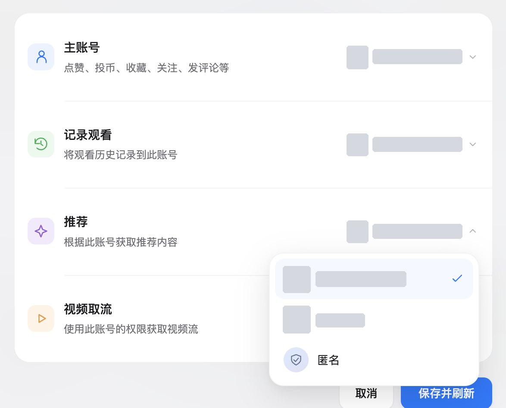
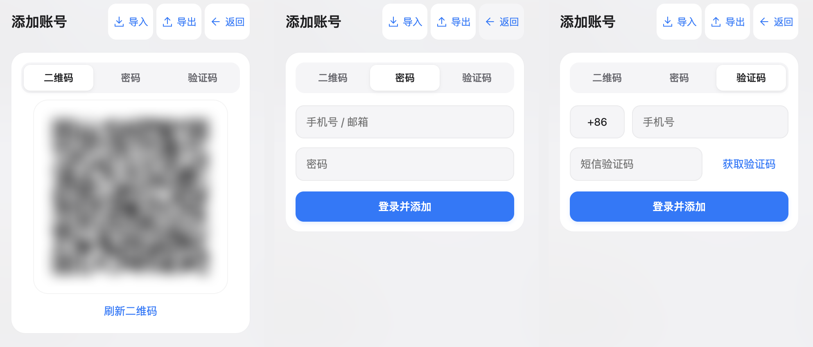

# Bilibili Multi-Account ｜哔哩哔哩多账号管理

为哔哩哔哩带来更灵活的多账号体验，在同一个页面，让不同账号各司其职。

## 你的账号，一处安排。

打开页面右下角的哔哩哔哩图标，账号池和用途分配就在眼前。查看账号是否有效、是否拥有大会员，再为每一种用途选好账号。完成后，点击「保存并刷新」，新的安排便会生效。

点赞、投币、收藏、关注和评论，由主账号完成。观看历史记到你选定的账号，推荐内容依据另一个账号获取，视频则使用指定账号的权限取流。

你可以让四种用途共用一个账号，也可以分别选择。例如，保留常用账号的互动身份与观看记录，同时使用另一个已有大会员的账号获取视频流。

点开每一项右侧的账号菜单，即可选择当前登录账号、账号池中的其他账号，或「匿名」。

## 添加账号，用你熟悉的方式。

点击「添加账号」，可以选择二维码、密码或短信验证码登录。已有 Cookie，也可以通过「导入」加入账号池。

账号集中管理，用途分别安排。以后需要调整，回到面板重新选择即可。

## 换个浏览器，接着用。

通过「导出」，将账号和用途分配保存到文件或剪贴板；在另一处安装脚本后，再通过「导入」恢复。已有的 Cookie 文本和兼容的账号 JSON，也可以从文件或剪贴板导入。

导出的备份包含登录凭据，请妥善保管，仅在自己的设备间传递。

## 几步安装，就能开始。

1. 在浏览器中安装 **脚本猫（ScriptCat）** 或 **Tampermonkey（篡改猴）** 扩展。
2. 打开本项目的[脚本安装文件](https://github.com/Wow-CaiCai/bilibili-multi-account/releases/latest/download/bilibili-multi-account.user.js)。
3. 在脚本管理器中确认安装。
4. 打开或刷新哔哩哔哩网页，右下角出现账号管理图标，即可开始使用。

## 关于账号与支持范围。

- **适用页面**：哔哩哔哩网页，独立登录页 `passport.bilibili.com` 除外。
- **播放权限**：取决于所选账号本身拥有的权益，以及视频的可用范围。
- **匿名选项**：对应用途不使用账号身份；需要登录或会员权限的功能可能无法使用。
- **账号状态**：可以在账号池中查看，也可以点击「更新账号信息」刷新资料。登录失效时，需要重新登录或导入有效 Cookie。
- **观看记录**：按选定账号上报；关闭页面瞬间的上报可能被浏览器中断。
